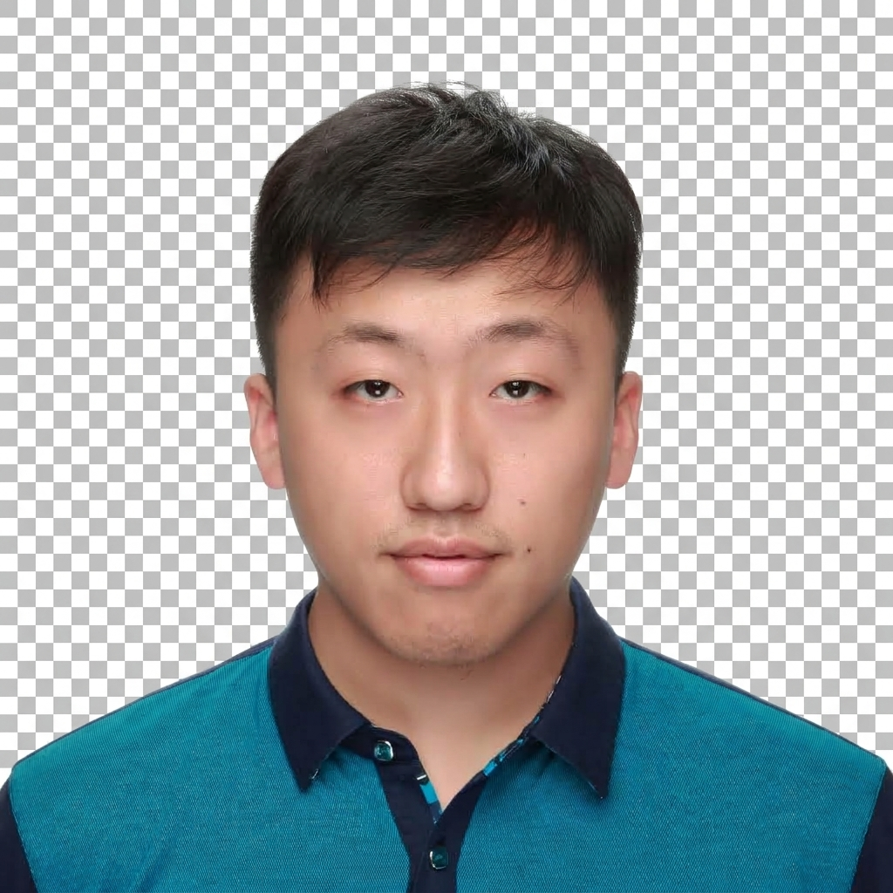

---
layout: splash

title: "Yubing Jian"
permalink: /
classes: wide
masthead: false

header:
  overlay_color: "#101820"
  overlay_filter: 0.86
  overlay_image: https://images.unsplash.com/photo-1519501025264-65ba15a82390?q=80&w=1740&auto=format&fit=crop

#header:
#  overlay_color: "#101820"
#  overlay_filter: 0

excerpt: >
  Wireless Systems Architect
    
  <strong>I am interested in building intelligent wireless systems.</strong> Designing high-performance wireless and networking systems by optimizing hardware and software architectures, leveraging classical and machine learning algorithms powered by big data analytics.
    
  Wireless systems &nbsp; / &nbsp; AI &nbsp; / &nbsp; Networking
    
  
    <a href="https://www.linkedin.com/in/yubing-jian/" target="_blank" rel="noopener">LinkedIn</a>
    <a href="https://scholar.google.com/citations?user=_onv1aoAAAAJ&hl=en" target="_blank" rel="noopener">Google Scholar</a>
    <a href="https://patents.google.com/?q=%22Yubing+Jian%22" target="_blank" rel="noopener">Google Patents</a>
    <a href="/assets/cv.pdf">CV</a>
  
#  
#    
#  

actions:
  - label: "Email me"
    url: "mailto:yubing.jian.2020@gmail.com"

  - label: "GitHub"
    url: "https://github.com/yubingjian"

  - label: "CV"
    url: "/assets/cv.pdf"
---